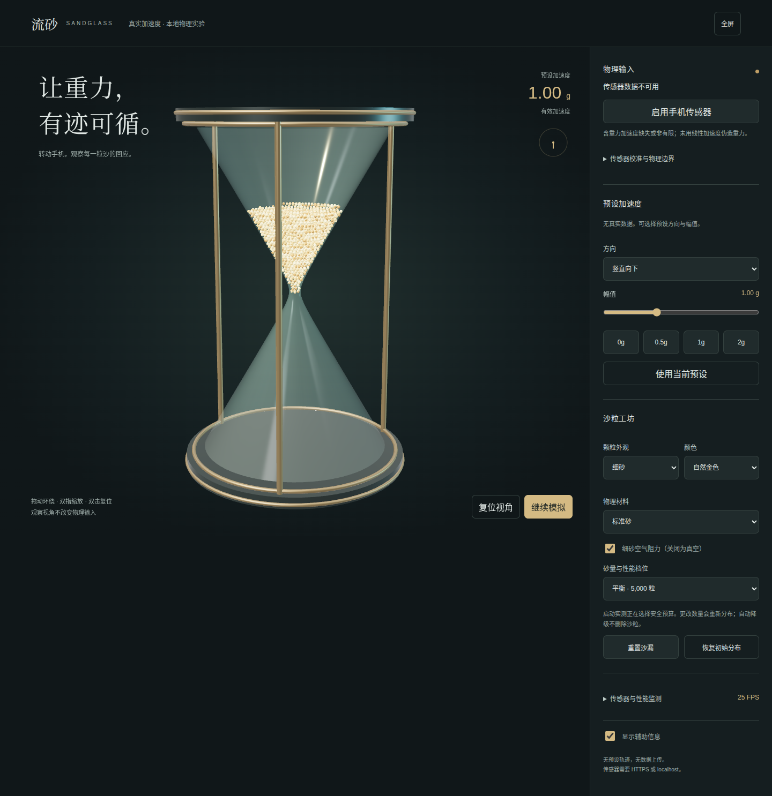

# 流砂 · Sandglass

一个可以握在手里玩的三维沙漏。转动手机，看沙子顺着新的方向流动；在电脑上，也可以用预设方向体验。

**[打开沙漏](https://nigh.github.io/sandglass/)** · 免费使用，无需登录。



## 怎么玩

1. 用手机浏览器打开上面的链接，点击「启用手机传感器」，允许访问运动与方向。
2. 缓慢倾斜或翻转手机，观察沙流。手机上固定为正面视角，让屏幕方向与沙粒运动对应。
3. 没有传感器或不想授权时，在「预设加速度」里选择方向和力度，再点「使用当前预设」。电脑上还可以拖动查看、滚轮缩放、双击复位视角。

手机默认使用反向读数。如果静止拿着手机时沙子向上跑，展开「传感器校准与物理边界」，切换「平台读数极性」。不同设备的读数方向可能不同。

## 可以调整什么

- **外观与颜色**：挑选细砂、粗砂或晶体外观，换一套颜色，不会打乱现有沙粒。
- **物理材料**：改变摩擦和碰撞时的弹性。外观与材料可以分开选择。
- **砂量与性能档位**：手机默认 1000 粒。数量越多，设备负担越重；更改数量会重新分布沙粒。
- **暂停模拟**：停在当前画面，再点一次继续。
- **重置沙漏 / 恢复初始分布**：让沙粒重新回到起始位置。
- **细砂空气阻力**：默认开启。关闭后可以观察没有空气阻力时的运动。

传感器有有效读数时会接管加速度，预设暂时不可用。数据中断时模拟不会擅自切回向下的重力；可以手动点击「使用当前预设」继续玩。

## 不流畅或没有反应？

**先试 1000 粒。** 帧率还低时，可以选择低面数的「细砂」外观。手机默认降低绘制像素密度；持续卡顿时应用也会降低画面开销，不会偷偷删除沙粒。

**允许传感器后仍没反应？** 请用 Safari 或 Chrome 直接打开 HTTPS 链接，检查浏览器的运动与方向权限，再刷新页面。电脑或部分设备没有可用传感器，可以直接使用预设。

**沙子卡在窄口？** 尝试缓慢改变倾角。当前模拟可能发生堵塞，不会强行放沙。

**沙子堆平了，帧率却没提高？** 当前 GPU 模拟仍会检查静止沙粒的碰撞，尚未实现 GPU 休眠。CPU 兼容路径有休眠机制，两者的表现会不同。

这是一个交互模拟。目前尚未可靠复现真实沙堆的临界角，也不能保证手机上 1000 粒达到流畅帧率。性能面板可查看 FPS，并导出 60 秒测试结果；本次尝试与已知限制见 [优化记录](docs/INVESTIGATION.md)。

## 在自己电脑上运行

安装 Node.js 20.19+ 或 22.12+，然后运行：

```sh
npm ci
npm run dev
```

打开终端显示的地址即可。手机传感器需要 HTTPS；手机通过普通局域网 HTTP 地址访问时，通常只能使用预设。

所有计算都在本地完成，不上传传感器数据。开发、部署和测试说明见 [开发文档](docs/DEVELOPMENT.md)。
